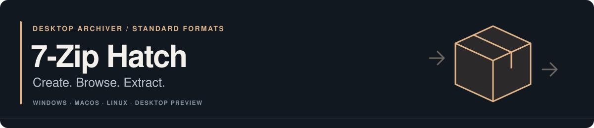

<p>
  
</p>

7-Zip Hatch combines **7-Zip 26.05**, **HatchZip 0.1.2**, and a desktop app for Windows, macOS, and Linux. Create, browse, test, and extract standard archives, with an optional mode that reclaims consumed source space during extraction.

[Download](#download) · [Features](#what-it-does) · [Space-saving limits](#before-using-space-saving-extraction) · [Build](#build-from-source) · [CLI guide](Hatch/CLI.md) · [Contribute](CONTRIBUTING.md)

> **0.2.0 desktop preview.** Ordinary extraction keeps the source archive. Space-saving extraction is opt-in and **changes and eventually removes it**. Evaluate the preview with replaceable copies and read the [limits](#before-using-space-saving-extraction) before using that mode.

## Download

| Platform | Preview download | Requirements |
| :--- | :--- | :--- |
| Windows x64 | [Setup.exe](https://github.com/chai-in/7zip-hatch/releases/download/v0.2.0/7zip-hatch-0.2.0-windows-x64-setup.exe) | Windows 10/11. Per-user installation and uninstall support. **Unsigned.** |
| macOS Apple silicon | [DMG](https://github.com/chai-in/7zip-hatch/releases/download/v0.2.0/7zip-hatch-0.2.0-macos-arm64.dmg) | Drag the app to Applications. Ad-hoc signed; **not Apple-notarized**. |
| Linux x86-64 | [AppImage](https://github.com/chai-in/7zip-hatch/releases/download/v0.2.0/7zip-hatch-0.2.0-linux-x86_64.AppImage) | glibc 2.39+ and an X11/Wayland desktop, such as Ubuntu 24.04. |

[All packages](https://github.com/chai-in/7zip-hatch/releases/tag/v0.2.0) · [SHA256SUMS](https://github.com/chai-in/7zip-hatch/releases/download/v0.2.0/SHA256SUMS) · [Install, verify, and remove](Hatch/DOWNLOADS.md)

On Linux:

```sh
chmod +x 7zip-hatch-0.2.0-linux-x86_64.AppImage
./7zip-hatch-0.2.0-linux-x86_64.AppImage
```

Without FUSE, add `--appimage-extract-and-run`. Windows setup includes the desktop app and original 7-Zip File Manager; **Tools → Space-saving extraction** opens the Hatch preview. Intel macOS and native ARM64 Windows/Linux packages are not currently published.

## What it does


*The published AppImage opening a disposable archive during its [desktop CI check](https://github.com/chai-in/7zip-hatch/actions/runs/40036590961). This is the running application; ordinary extraction is selected.*

| Operation | Behavior |
| :--- | :--- |
| Browse and test | Open or drop an archive, inspect entries, and check integrity. |
| Ordinary extraction | Keep the source archive. Stage output and publish it to a new or empty destination; cancellation removes partial output. |
| Space-saving extraction | Plan space use, confirm, then consume supported ZIP, 7z, tar, or gzip-tar source data as output becomes durable. |
| Create 7z or ZIP | Choose compression, codecs, dictionary size, solid blocks, threads, volumes, passwords, filename encryption, and advanced `-m` properties. Inputs are retained. |
| Pause and recover | Resume a consuming session or rebuild its unextracted remainder using HatchZip's journal. Partial restore is not a full undo. |
| Desktop integration | Finder Open With, optional Windows/Linux archive context menus, and the original Windows File Manager integration. |

The cross-platform app creates new archives and extracts whole archives. Use the original 7-Zip tools for archive updates, selected-entry operations, and native metadata switches. See the [desktop guide](Hatch/DESKTOP.md).

## Before using space-saving extraction

**Choose ordinary extraction when you need to keep the original archive.** Consuming mode has specific limits:

- It changes and eventually removes the source. Keep the journal and saved tail beside a paused archive until extraction or restore finishes.
- Solid 7z blocks must finish decoding before their space can be released. One large block may need as much free space as ordinary extraction. `-ms=64m` groups whole files; it does not split a large file.
- Reclaimed space helps output only on the **same filesystem**. Snapshots, clones, and filesystem behavior can delay reclamation; hole punching is filesystem-dependent.
- Fewer formats and metadata types are supported than by native 7-Zip. Partial restore rebuilds the unextracted remainder and retains extracted files; it cannot reconstruct consumed data and currently refuses encrypted 7z archives.

The app's plan describes the selected archive. Read the [format, filesystem, metadata, and recovery limits](Hatch/CLI.md#limits) before proceeding. There is no universal minimum-space or throughput claim.

## Build from source

Requirements: Rust 1.95.0, Python 3, and platform C/C++ build tools. Linux also needs `pkg-config` and Fontconfig development headers. Use a Visual Studio x64 Native Tools prompt on Windows, or Xcode Command Line Tools on macOS.

```sh
git clone https://github.com/chai-in/7zip-hatch.git
cd 7zip-hatch
python3 Hatch/build_desktop.py --jobs 4
```

On Windows, use `python` if that is your Python 3 launcher. Output is `build/desktop/7-Zip Hatch.app` on macOS or `build/desktop/7zip-hatch/` on Windows/Linux. Keep the native engine beside the desktop executable.

The [desktop build guide](Hatch/DESKTOP.md#build) covers toolchain notes and build options. To reproduce the published preview, use its named [application source bundle](https://github.com/chai-in/7zip-hatch/releases/download/v0.2.0/7zip-hatch-0.2.0-source-with-dependencies.tar.gz) and corresponding AppImage library sources. The [provenance guide](Hatch/DOWNLOADS.md#source-and-build-provenance) explains which revisions and dependencies those bundles contain.

## Command line

Normal 7-Zip commands still work. The `hatch` subcommand adds space planning and consuming extraction:

```sh
7zz a backup.7z files/
7zz x backup.7z

# Read-only space planning and integrity checking
7zz hatch check backup.7z --keep-free 2GB
7zz hatch test backup.7z

# Consumes the archive after confirmation; use a replaceable copy
7zz hatch extract backup.7z -o extracted --verify-first --keep-free 2GB
```

Use `7zz.exe` on Windows. The [CLI guide](Hatch/CLI.md) covers passwords, resume, restore, split volumes, exit codes, and limits.

## Documentation and contribution

| For | Read |
| :--- | :--- |
| Installation and everyday use | [Downloads and verification](Hatch/DOWNLOADS.md) · [Desktop guide](Hatch/DESKTOP.md) · [CLI guide](Hatch/CLI.md) |
| Development | [Design](Hatch/DESIGN.md) · [Installer builds](Hatch/installers/README.md) · [Validation record](Hatch/VALIDATION.md) |
| Changes and collaboration | [Changelog](CHANGELOG.md) · [Contributing](CONTRIBUTING.md) · [Code of conduct](CODE_OF_CONDUCT.md) |
| Help and reports | [Support](SUPPORT.md) · [Discussions](https://github.com/chai-in/7zip-hatch/discussions) · [Security policy](SECURITY.md) |

Reproducible archive fixtures, bug reports, documentation fixes, and accessibility improvements are welcome. The validation record distinguishes tested behavior from platform and filesystem limits.

## Free software and attribution

This is an independent fork of [7-Zip](https://github.com/ip7z/7zip) and [HatchZip](https://github.com/xevrion/hatchzip). Its work integrates the extraction engines, extends the desktop workflow, and adds platform packaging. Archives use standard formats; no special reader is required.

| Component | License |
| :--- | :--- |
| Complete Slint desktop application | [GPL-3.0](Hatch/COPYING-GPL-3.0.txt) |
| Separate 7-Zip CLI, Windows File Manager, and integration | [LGPL-2.1-or-later](LICENSE), with original BSD/public-domain exceptions and notices |
| Original HatchZip sources | [MIT](third_party/hatchzip/LICENSE-MIT) OR [Apache-2.0](third_party/hatchzip/LICENSE-APACHE) |
| Bundled dependencies | Their own notices, included in each binary package |

Default FOSS builds exclude RAR decompression codecs carrying the unRAR restriction. RAR listing and stored entries remain available; other RAR extraction may require another tool. The optional `--with-rar` source build opts into the original additional terms.

Credit belongs to Igor Pavlov and the 7-Zip contributors, Yash Bavadiya and the HatchZip contributors, and the dependency projects. See [NOTICE](NOTICE) and the [original 7-Zip notices](DOC/License.txt). No upstream ownership or endorsement is implied.
