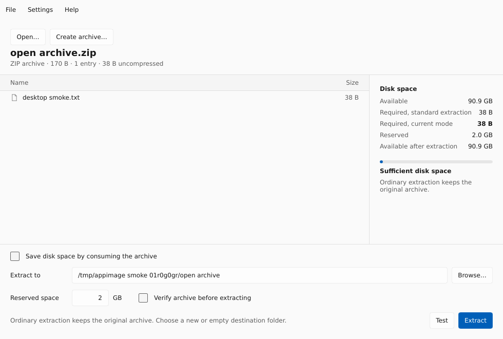

<p align="center">
  
</p>

<h1 align="center">7-Zip Hatch</h1>

<p align="center"><strong>Create, browse, and extract archives. Reclaim space as you extract.</strong></p>

<p align="center">
  <a href="https://github.com/chai-in/7zip-hatch/actions/workflows/ci.yml"></a>
  <a href="https://github.com/chai-in/7zip-hatch/actions/workflows/installers.yml"></a>
  <a href="https://github.com/chai-in/7zip-hatch/releases/tag/v0.2.0"></a>
</p>

<p align="center">
  <a href="#download">Download</a> |
  <a href="#what-it-does">Features</a> |
  <a href="Hatch/CLI.md">CLI guide</a> |
  <a href="CONTRIBUTING.md">Contribute</a> |
  <a href="https://github.com/chai-in/7zip-hatch/discussions">Questions</a>
</p>

7-Zip Hatch combines **7-Zip 26.05** with **HatchZip 0.1.2** and a desktop
app for Windows, macOS, and Linux. Normal 7-Zip commands still work. The new
space-saving mode extracts supported archives while releasing consumed source
space, with a plan, confirmation, verification options, and recovery controls.

Archives use standard formats, including `.7z`. No special archive reader is
needed. This is an independent fork of [7-Zip](https://github.com/ip7z/7zip)
and [HatchZip](https://github.com/xevrion/hatchzip), with their original notices
and component licenses preserved.

## Download

**Current release: [0.2.0 desktop preview](https://github.com/chai-in/7zip-hatch/releases/tag/v0.2.0).**
Preview software should be evaluated with replaceable copies of archives.
Ordinary extraction keeps the archive. Space-saving extraction is opt-in and
consumes it; read [the limits](#before-using-space-saving-extraction) first.

| Platform | Recommended download | Requirements and installation |
| --- | --- | --- |
| Windows x64 | [Setup.exe](https://github.com/chai-in/7zip-hatch/releases/download/v0.2.0/7zip-hatch-0.2.0-windows-x64-setup.exe) | Windows 10/11. Per-user installation, Start menu entries, optional desktop/right-click shortcuts, and uninstall support. Unsigned. |
| macOS Apple Silicon | [DMG](https://github.com/chai-in/7zip-hatch/releases/download/v0.2.0/7zip-hatch-0.2.0-macos-arm64.dmg) | Drag **7-Zip Hatch.app** to Applications. Ad hoc signed; not Apple-notarized. |
| Linux x86-64 | [AppImage](https://github.com/chai-in/7zip-hatch/releases/download/v0.2.0/7zip-hatch-0.2.0-linux-x86_64.AppImage) | glibc 2.39+ and an X11/Wayland desktop, such as Ubuntu 24.04. Make executable, then launch. |

[All downloads and portable packages](https://github.com/chai-in/7zip-hatch/releases/tag/v0.2.0)
| [Install, remove, and verify downloads](Hatch/DOWNLOADS.md)
| [SHA256SUMS](https://github.com/chai-in/7zip-hatch/releases/download/v0.2.0/SHA256SUMS)
| [Application source bundle](https://github.com/chai-in/7zip-hatch/releases/download/v0.2.0/7zip-hatch-0.2.0-source-with-dependencies.tar.gz)

On Linux:

```sh
chmod +x 7zip-hatch-0.2.0-linux-x86_64.AppImage
./7zip-hatch-0.2.0-linux-x86_64.AppImage
```

Without FUSE, add `--appimage-extract-and-run`. Windows setup includes both the
new desktop app and the original 7-Zip File Manager. Its **Tools > Space-saving
extraction** command opens the Hatch preview. Intel macOS and native ARM64
Windows/Linux packages are not currently published.

## What it does



*The actual 0.2.0 AppImage opening an archive during its
[desktop CI test](https://github.com/chai-in/7zip-hatch/actions/runs/40036590961).
The archive is retained in the default extraction mode.*

| Operation | Behavior |
| --- | --- |
| Browse and test | Open or drop an archive, inspect its entries, and check integrity. |
| Ordinary extraction | Keeps the source archive. Stages output, then publishes it to a new or empty destination. Cancellation removes partial output. |
| Space-saving extraction | Plans space use, asks for confirmation, and consumes supported ZIP, 7z, tar, and gzip-tar archives as output becomes durable. |
| Create 7z or ZIP | Set compression level, codec, dictionary, solid blocks, threads, volumes, passwords, filename encryption, and advanced `-m` properties. Inputs are retained. |
| Pause, resume, and partial restore | Continue a consuming session or rebuild its unextracted remainder using HatchZip's journal. Restore is not a full undo. |
| Desktop integration | Finder Open With on macOS; user-level archive right-click entries on Windows and Linux. Registration opens a preview before consuming extraction. |
| Original 7-Zip | Use `7zz` or the Windows File Manager for archive updates, selected-entry operations, and native metadata switches. |

The cross-platform GUI creates new archives and extracts whole archives.
The [desktop guide](Hatch/DESKTOP.md) explains its options and platform integration.

## Before using space-saving extraction

- **It changes and eventually removes the source archive.** Use ordinary
  extraction when the original must be kept. Keep the journal and saved tail
  beside a paused archive until extraction or restore finishes.
- **Solid 7z blocks limit reclamation.** A block must finish decoding before
  it can be released. One large block may need as much free space as ordinary
  extraction. `-ms=64m` groups whole files; it does not split one huge file.
- Reclaimed space helps the output only on the **same filesystem**.
  Snapshots, clones, and filesystem behavior can delay actual reclamation.
- Consuming mode supports fewer formats and metadata types than native
  7-Zip. Hole punching is filesystem-dependent. Partial restore retains
  extracted files and rebuilds the remaining archive; it cannot reconstruct
  already consumed data and currently refuses encrypted 7z archives.

See [format, filesystem, metadata, and recovery limits](Hatch/CLI.md#limits)
before choosing consuming mode. The app's space plan describes the actual archive.

## Command line

```sh
# Existing 7-Zip commands
7zz a backup.7z files/
7zz x backup.7z

# Read-only space planning and integrity checking
7zz hatch check backup.7z --keep-free 2GB
7zz hatch test backup.7z

# Consumes the archive after confirmation; use a replaceable copy
7zz hatch extract backup.7z -o extracted --verify-first --keep-free 2GB
```

Use `7zz.exe` on Windows. The native CLI is bundled with each desktop package.
[The CLI guide](Hatch/CLI.md) covers passwords, resume, restore, exit codes,
split volumes, and the full format limits. `7zz hatch <command> --help` lists
the command's options.

## Documentation and contribution

- [Install, verify, and remove](Hatch/DOWNLOADS.md)
- [Desktop features and builds](Hatch/DESKTOP.md)
- [CLI use and limits](Hatch/CLI.md)
- [Design and upstream source study](Hatch/DESIGN.md)
- [Installer builds and validation](Hatch/installers/README.md)
- [Changes](CHANGELOG.md), [contributing and development checks](CONTRIBUTING.md)
- [Support](SUPPORT.md), [security reports](SECURITY.md), [code of conduct](CODE_OF_CONDUCT.md)

Bug reports, reproducible archive fixtures, documentation fixes, accessibility
improvements, and reviewed code changes are welcome. Start with
[contributing](CONTRIBUTING.md) or ask in [Discussions](https://github.com/chai-in/7zip-hatch/discussions).

## Free software and attribution

| Component | License |
| --- | --- |
| Complete Slint desktop application | [GPL-3.0](Hatch/COPYING-GPL-3.0.txt) |
| Separate 7-Zip CLI, Windows File Manager, and integration | [LGPL-2.1-or-later](LICENSE), with original BSD/public-domain exceptions and notices |
| Original HatchZip component sources | [MIT](third_party/hatchzip/LICENSE-MIT) OR [Apache-2.0](third_party/hatchzip/LICENSE-APACHE) |
| Bundled dependencies | Their own notices, included in each binary package |

Default FOSS builds exclude RAR decompression codecs carrying the unRAR
restriction. RAR listing and stored entries remain available; other RAR
extraction may require a different tool. An explicit `--with-rar` source
build opts into the original additional terms.

Credit belongs to Igor Pavlov and the 7-Zip contributors, Yash Bavadiya and
the HatchZip contributors, and the projects whose dependencies make this
application possible. See [NOTICE](NOTICE) and [the original 7-Zip notices](DOC/License.txt).
No upstream ownership or endorsement is implied.

Release source bundles include the committed application tree, locked Cargo
sources, and corresponding sources for added AppImage libraries. See
[release and source provenance](Hatch/DOWNLOADS.md#source-and-build-provenance).
